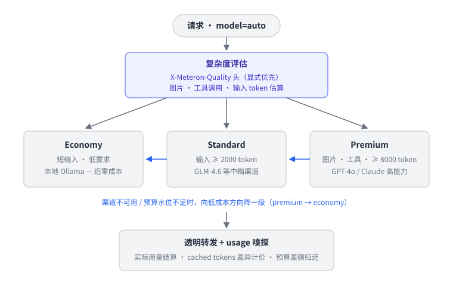

# Meteron Token 节省机制分析

> 分析对象：Meteron（AI Token 计量计费网关）
> 核心问题：如何在**不降低 AI 能力**的前提下节省 token 成本
> 结论先行：内容层零改动，只在「选哪个模型执行」和「怎么计费管控」两个维度省钱。

## 设计立场

Meteron 刻意**不做** prompt 压缩、消息截断这类会真实降低 AI 能力的手段。所有节省都发生在两个对请求内容透明的维度上：

1. **执行侧**——选哪个模型执行（auto 成本分级路由）
2. **计费侧**——怎么计量与管控（cached tokens 差异定价、预算两阶段、幂等防重）

---

## 一、执行侧：auto 成本分级路由（核心省钱机制）



> 图源文件为 [token-saving-routing.svg](token-saving-routing.svg)（纯文本 SVG，可直接编辑）。
> 蓝色箭头为降级方向（premium → standard → economy）；灰色箭头为主流程。

### 代码位置

| 文件 | 职责 |
|---|---|
| `internal/router/engine.go` | `ResolveAuto` / `evalTier`：复杂度评估 → 成本分级决策 |
| `internal/gateway/handler.go` | `buildProfile`：从请求提取复杂度信号 |
| `internal/config/config.go` | `cost_tier` 渠道分级配置（economy / standard / premium） |

### 分级判定规则（优先级从高到低）

| 信号 | 判定 | 去向 |
|---|---|---|
| `X-Meteron-Quality: low/medium/high`（显式头） | 直接映射 | economy / standard / premium |
| 消息含 `image_url`（多模态） | 能力刚需 | premium |
| `tools` 非空（工具调用） | 能力刚需 | premium |
| 输入估算 ≥ 8000 token | 需大上下文 | premium |
| 输入估算 ≥ 2000 token | 中等 | standard |
| 其余（短文本问答） | 低复杂度 | economy |

其中 economy 分级通常指向本地 Ollama / vLLM 等部署（近零边际成本），standard 指向中档商用渠道（如 GLM-4.6），premium 指向高能力渠道（GPT-4o / Claude）。

### 为什么不降能力

降级判据**全部是能力信号**，而不是单纯的成本信号：

- **多模态、工具调用、长上下文**这些真正需要强模型的特征会强制路由到 premium——需要高能力的请求不会被降级；
- 只有**短输入、无工具的简单请求**才走廉价渠道——这类请求用便宜模型的质量损失可以忽略；
- **逃生舱**：应用若自知请求复杂（比如短输入但逻辑难），可用 `X-Meteron-Quality: high` 头强制 premium，把最终裁量权交给最了解请求语义的应用侧。

### 降级链路

- 降级方向永远是低成本**单向**的（`tierOrder`：economy → standard → premium）；
- 目标分级无可用渠道时逐级向低成本降（premium → standard → economy），可用性优先；
- 预算池水位低于 `budget_watermark` 时，auto 结果同样向低成本降一级（省钱优先）；
- economy 分级同时也是 auto 路由的兜底 fallback。

### 零成本估算

输入 token 估算只是字符数 ÷ `EstimateCharsPerToken`（默认 4），不调用任何 tokenizer——评估本身零开销、毫秒级完成。

---

## 二、预算管控：防超支但不硬砍

### 两阶段预留（`internal/ledger`）

1. **请求前（reserve）**：按 `max_tokens`（或默认 1024）估算金额，Redis 原子扣减预算缓存 + PG 预留表落库复核；
2. **响应后（confirm）**：按实际 usage 精确结算，差额自动归还——预算不被虚占，也不超卖。

预留金额按请求命中的**费率快照单价**估算（与实际计费同口径），高价模型的预留随真实费率水涨船高，封住超卖窗口。

### 超支三策略（`exhaust_policy`）

| 策略 | 行为 |
|---|---|
| `block` | 超支拒绝（最严格） |
| `warn` | 告警放行（超支通过指标与对账暴露） |
| `fallback` | **自动切换廉价模型**——切换后按 fallback 模型的费率快照重新估价再预留，保证预留与实际计费同口径 |

`fallback` 策略是「省钱不断服」的关键：预算不足时服务不中断，请求自动降到廉价模型执行。

---

## 三、计费侧：cached tokens 差异化定价

### 缓存计量全渠道覆盖

| 组件 | 机制 |
|---|---|
| `internal/gateway/sse.go` | SSE 嗅探器解析 `prompt_tokens_details.cached_tokens` |
| `internal/provider/openai.go` | OpenAI 兼容渠道解析 `prompt_tokens_details` |
| `internal/provider/anthropic.go` | 把 `cache_read_input_tokens` 翻译为统一 `CachedInputTokens` 格式 |

### 差异化计价（`internal/pricing/calc.go`）

计价引擎支持 `CachedInputUnitPrice` 独立单价：**缓存命中的输入 token 按低价计**。

这是经济激励设计：应用侧做 prompt caching（对模型完全透明、能力无损）后，多轮长上下文对话的成本大幅下降，账单上直接可见收益。

---

## 四、网关自身零 token 开销 + 防重复消耗

### 透明转发

- 请求体**原样透传**，仅在路由/降级切换模型时重写 `model` 字段（`rewriteBodyModel` 用 `map[string]json.RawMessage` 保留所有未知字段），不注入任何系统提示或元数据——网关自身不给请求增加一个 token；
- 流式请求注入的 `stream_options.include_usage` 是请求选项（用于流末尾返回 usage），不影响计费内容；
- 路由切换模型后同步重写 body.model，保证「计费模型 = 实际执行模型」。

### 重试不重复烧 token（`internal/provider/retry.go`）

| 规则 | 原因 |
|---|---|
| 只重试「拿到响应头之前」的网络错误 / 5xx | 建立请求阶段未产生推理成本 |
| 流式响应一旦开始透传**绝不重放** | 部分 chunk 已发给客户端，重放会双倍烧 token 且破坏流一致性 |
| 4xx 不重试 | 请求本身有问题，重发必然同样失败 |
| 最多 3 次尝试，退避 500ms / 1500ms | 抑制瞬时抖动，不放大流量 |

### 幂等防重（`X-Idempotency-Key` → UUIDv5）

- 同租户同 `transaction_id` 已占用则拒绝重复提交，防止同键重放产生双倍计量；
- 占用独立落表 `idempotency_keys`（`ON CONFLICT DO NOTHING` 原子占用），与预算池无关的请求同样受保护。

### 失败不计费

| 场景 | 处理 |
|---|---|
| 网络错误 | 预留全额释放 + tokens=0 审计事件（status_code=502） |
| 上游 4xx/5xx | 预留全额释放 + tokens=0 审计事件（真实状态码） |
| 上游 2xx 但缺 usage | tokens=0 审计事件（metadata 标记 `missing_usage`），预留等 TTL 过期释放 |
| SSE 中途断开 | 不 confirm，等 ScheduledWorker 过期释放；若已捕获 usage 仍如实计费（LLM 成本已发生） |

### 输入校验

`max_tokens ≤ 1,000,000` 上限校验：防止天文数字（如 MaxInt64）使 token 估算 int64 溢出为负值，从而绕过 TPM 限流并污染滑动窗口。

---

## 五、边界与取舍

### 已知取舍

- **启发式是粗的**：字符 ÷ 4 的估算不含图片权重、不识别逻辑复杂度，短输入但逻辑复杂的请求可能被误判到 economy。这正是 `X-Meteron-Quality` 头存在的原因——把裁量权交还应用侧。
- **分级阈值可调**：`policy_config.auto.standard_min_input_tokens` / `premium_min_input_tokens`（默认 2000 / 8000）与各级目标渠道均可按业务覆盖。
- **auto 模式受密钥白名单约束**：使用 auto 的密钥需在 `model_allow_list` 放行所有可能路由到的模型。

### 机制总览

```
请求 ──> 复杂度评估（Quality 头 > 图片/工具/长输入启发式）
     ──> 成本分级（economy / standard / premium）
     ──> 预算水位不足时向低成本降一级
     ──> 透明转发（零内容改动，仅可能重写 model 字段）
     ──> usage 嗅探（含 cached tokens）
     ──> 按实际用量结算（cached 差异计价，差额归还预算）
```

| 维度 | 机制 | 对能力的影响 |
|---|---|---|
| 模型选择 | auto 成本分级路由 | 无（能力信号强制走高能力渠道，简单请求才降级） |
| 预算管控 | 两阶段预留 + fallback | 无（超支降级是显式策略，非静默截断） |
| 计费口径 | cached tokens 差异定价 | 无（缓存对模型透明） |
| 网关开销 | 透明转发，零注入 | 无 |
| 重复消耗 | 重试边界 + 幂等键 | 无（防的是浪费，不是能力） |
